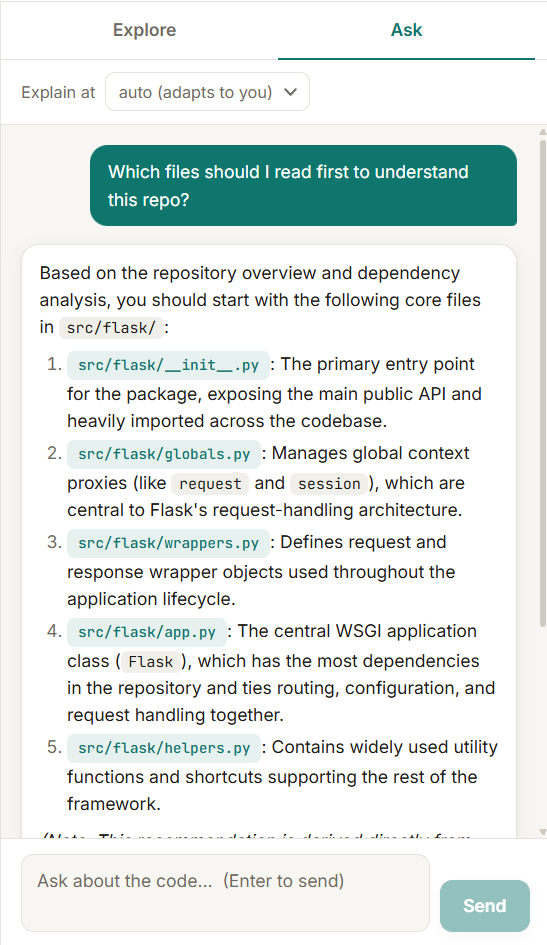

# RepoMind

Understand any codebase in minutes. RepoMind analyzes a GitHub repo or a ZIP file, draws its dependency graph, and lets you ask questions about the code. Answers cite the exact files and line numbers.

## Screenshots

**Dependency graph (Flask)**


**Asking a question (Flask)**



## Features

- Analyze a public GitHub URL or upload a `.zip` file
- Interactive dependency graph (node size = importance)
- Most important and most imported files, plus circular dependency detection
- Ask questions in plain language, with answers citing `path:start-end`
- Explanation level adapts to the user
- Automatic retries and fallback models if Gemini is busy

## Supported languages

Python, JavaScript, TypeScript, Java, Go, Rust, Ruby, C and C++.

Links appear in the graph only when a file imports another file inside the repo.

## Limits

- Needs real source code. Repos with only a README or data files show 0 files.
- Public repos only (no GitHub token support).
- Go needs a `go.mod`; Rust expects a `src/` folder.

## Run it locally

You need Python 3.11+, Node.js, and a free Gemini API key from Google AI Studio.

```bash
git clone https://github.com/khananas4513/RepoMind.git
cd RepoMind

# Backend
python -m venv venv
venv\Scripts\activate          # Windows
pip install -r requirements.txt
copy .env.example .env         # then put your key in .env
uvicorn backend.main:app

# Frontend (second terminal)
cd frontend
npm install
npm run dev
```

Open http://localhost:5173.

The first install is large (PyTorch comes with sentence-transformers), and the first analysis downloads an embedding model, so expect a short delay.

Set `GOOGLE_API_KEY` in `.env`. Optionally set `LLM_MODELS` to a comma-separated list of Gemini models (best first); otherwise Google's `-latest` aliases are used.

## Tech stack

FastAPI, LangChain with Google Gemini, tree-sitter, sentence-transformers, FAISS, NetworkX, React and Vite.

## Security

Never commit your `.env` file. It is listed in `.gitignore`.